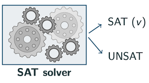

# SatyPy: SAT Solver through Unique Games and Vertex Cover



This work builds upon [SatyPy: SAT Solver](https://github.com/frankvegadelgado/satypy).

# Boolean Satisfiability (SAT) Problem

**Problem:** Given a Boolean formula in Conjunctive Normal Form (CNF), is there a truth assignment that makes the formula evaluate to true?

**Background:**

The Boolean Satisfiability Problem (SAT) is a fundamental problem in computer science. It is known to be NP-complete, which means that any problem whose solution can be verified in polynomial time can be reduced to SAT. This implies that SAT is likely to be computationally difficult, although there is no proof of this.

**Concepts:**

- **Literal:** A variable or its negation (e.g., $x$ or $\neg x$).
- **Clause:** A disjunction (OR) of one or more literals (e.g., $x \vee \neg y \vee z$).
- **Conjunctive Normal Form (CNF):** A Boolean formula where each clause is connected by conjunction (AND).
- **Truth Assignment:** An assignment of truth values (true or false) to all variables in a formula.
- **Satisfying Truth Assignment:** A truth assignment that makes a formula evaluate to true.
- **Satisfiable Formula:** A formula that has a satisfying truth assignment.

**Example:**

Consider the formula $(x_1 \vee ¬x_3 \vee ¬x_2) \wedge (x_3 \vee x_2 \vee x_4)$, where $\vee$ (OR), $\wedge$ (AND) and $\neg$ (NEGATION) are the logic operations. This formula is in CNF with four variables ($x_1$, $x_2$, $x_3$, and $x_4$) and two clauses. A possible satisfying truth assignment is ($x_1$: False, $x_2$: False, $x_3$: True, and $x_4$: False).

**Input format:**

The input for SAT solvers is typically provided in [DIMACS](https://jix.github.io/varisat/manual/0.2.0/formats/dimacs.html) format (`.cnf` files). A DIMACS file consists of three parts:

1. **Header:** The first line specifies the number of variables (n) and clauses (m) in the formula using the format `p cnf n m`.
2. **Clauses:** Each subsequent line represents a clause, where each literal is represented by a variable's index (positive for the variable, negative for its negation). A zero at the end of the line indicates the end of the clause.

**Example `.cnf` file:**

```
p cnf 4 2
1 -3 -2 0
3 2 4 0
```

This is a `.cnf` file representing a Boolean formula in Conjunctive Normal Form (CNF) for the Boolean Satisfiability Problem (SAT). Let's break down what each line means:

- **Header (p cnf 4 2):**

  - `p cnf` indicates it's a CNF formula in DIMACS format.
  - `4` specifies the number of variables in the formula ($x_1$, $x_2$, $x_3$, and $x_4$ in this case).
  - `2` specifies the number of clauses (disjunctions of literals) in the formula.

- **Clauses (1 -3 -2 0 and 3 2 4 0):**
  - Each line represents a clause.
  - A positive integer represents a variable (e.g., `1` represents variable $x_1$).
  - A negative integer represents the negation of a variable (e.g., `-3` represents $\neg x_3$).
  - `0` at the end of the line indicates the end of the clause.

**Explanation of the clauses:**

- `1 -3 -2 0`: This clause translates to $(x_1 \vee \neg x_3 \vee \neg x_2)$, which means at least one of $x_1$, $\neg x_3$, or $\neg x_2$ must be true for the clause to be true.
- `3 2 4 0`: This clause translates to $(x_3 \vee x_2 \vee x_4)$, which means at least one of $x_3$, $x_2$, or $x_3$ must be true for the clause to be true.

**In essence, the formula represented by this `.cnf` file is asking if there exists an assignment of truth values (true or false) to the variables $x_1$, $x_2$, $x_3$, and $x_4$ that makes both clauses true simultaneously.**

## Installation and Setup

**1. Install Python:**

- Ensure you have Python 3.12 or a later version installed on your system. You can download and install it from the official Python website: https://www.python.org/downloads/

**2. Install SatyPy's Library:**

- Open your terminal or command prompt.
- Use `pip` to install the SatyPy library and its dependencies:

```bash
pip install satypy
```

## Running the SAT Solver with SatyPy

**Using SatyPy's built-in benchmarks:**

1. **Install SatyPy's library:**

   If you haven't already, follow the installation steps in the previous section to install SatyPy.

2. **Download SatyPy's library:**

   Download the benchmarks from the GitHub repository.

```bash
git clone https://github.com/frankvegadelgado/satypy.git
```

3. **Execute the script:**

   Open your terminal or command prompt and navigate to the directory where you downloaded SatyPy (e.g., using `cd satypy`).

   Run the following command to solve a sample `.cnf` file named `file.cnf` included with SatyPy's benchmarks:

```bash
   saty -i benchmarks/simple/file.cnf
```

SatyPy supports compressed `.cnf` files, including `.xz`, `.lzma`, `.bz2`, and `.bzip2` formats.

**Output Interpretation:**

## If the formula is satisfiable, the console output will display:

```
s SATISFIABLE
v 2 4 -3 -1 0
```

- **`s SATISFIABLE`:** This line indicates that the SAT solver found a satisfying truth assignment for the given formula.
- **`v 3 -4 -1 -2 0`:** This line provides the satisfying truth assignment.
  - Positive numbers (e.g., `2`, `4`) represent variables assigned the value "True".
  - Negative numbers (e.g., `-1`, `-3`) represent variables assigned the value "False".
  - `0` marks the end of the truth assignment.

## If the formula is unsatisfiable, the console output will display:

```
s UNSATISFIABLE
```

## If the solver cannot decide, the console output will display:

```
s UNKNOWN
```

## SAT Benchmarks and Testing

SatyPy includes a collection of sample `.cnf` files in the `benchmarks/file-dimacs-aim` directory. These files can be used to test the functionality of the SAT solver. The files are derived from the well-known [SAT Benchmarks](https://www.cs.ubc.ca/~hoos/SATLIB/Benchmarks/SAT/DIMACS/AIM/descr.html) dataset.

**Running Sample Benchmarks:**

1. **Ensure SatyPy is installed:** Follow the installation steps in the previous section if you haven't already installed SatyPy.

2. **Execute the script:** Open your terminal or command prompt and navigate to the directory where SatyPy was downloaded.

You can then use the `saty` command to run the sample benchmarks. For example, the following commands demonstrate running two sample files:

- Test the satisfiable formula `aim-50-1_6-yes1-1.cnf`:

  ```
  saty -i benchmarks/file-dimacs-aim/aim-50-1_6-yes1-1.cnf
  s SATISFIABLE
  v 2 3 7 8 9 14 17 18 19 20 21 22 23 24 26 27 28 30 31 35 36 38 39 40 41 42 43 46 48 -50 -49 -47 -45 -44 -37 -34 -33 -32 -29 -25 -16 -15 -13 -12 -11 -10 -6 -5 -4 -1 0
  ```

A satisfiable formula means there exists a truth assignment that makes the formula true. The output will indicate this with s SATISFIABLE followed by the satisfying truth assignment.

- Test the unsatisfiable formula `aim-50-1_6-no-1.cnf`:

  ```
  saty -i benchmarks/file-dimacs-aim/aim-50-1_6-no-1.cnf
  s UNSATISFIABLE
  ```

running these sample benchmarks, you can verify that SatyPy is functioning correctly and gain experience using the `saty`

## Command-Line Options

To view the available command-line options for the `saty` command, use the following command in your terminal or command prompt:

```bash
saty -h
```

This will display the help message, which provides information about the available options and their usage:

```bash
usage: saty [-h] -i INPUTFILE [-a] [-b] [-c] [-m MAX_CLAUSES] [-v] [-t] [-l] [--version]

Solve the Boolean Satisfiability (SAT) problem using a DIMACS file as input.

options:
  -h, --help            show this help message and exit
  -i INPUTFILE, --inputFile INPUTFILE
                        Input file path
  -a, --approximation   enable comparison with a known SAT solver (MiniSat 2.2 via python-sat)
  -b, --bruteForce      enable comparison with the exponential-time brute-force approach (at most 30 variables)
  -c, --count           only state whether the formula is SATISFIABLE, UNSATISFIABLE or UNKNOWN
  -m MAX_CLAUSES, --max_clauses MAX_CLAUSES
                        largest 3-SAT formula sent to the Vertex Cover stage (about 1,900 vertices,
                        11,800 edges and 24 MB per clause; default: 100)
  -v, --verbose         Enable verbose output
  -t, --timer           Enable timer output
  -l, --log             Enable file logging
  --version             show program's version number and exit
```

Available Options:

    -h, --help: Displays this help message and exits the program.
    -i INPUTFILE, --inputFile INPUTFILE: Specifies the path to the input file containing the Boolean formula. This option is required.
    -a, --approximation: Also solves the formula with MiniSat 2.2 and reports both answers.
    -b, --bruteForce: Also solves the formula by exhaustive search (skipped above 30 variables).
    -c, --count: Prints only SATISFIABLE, UNSATISFIABLE or UNKNOWN instead of the DIMACS assignment.
    -m MAX_CLAUSES, --max_clauses MAX_CLAUSES: Larger 3-SAT formulas skip the Vertex Cover stage and are reported as UNKNOWN.
    -v, --verbose: Enables verbose output, providing more detailed information about the solver's progress.
    -t, --timer: Enables timer output, displaying the time taken by the solver to find a solution.
    -l, --log: Enables file logging, writing detailed information about the solver's execution to a log file.

With `-a` or `-b` every answer is prefixed by its source and any disagreement is reported, for example:

```
saty -i benchmarks/simple/file.cnf -a -b -c
file.cnf: (MiniSat) SATISFIABLE
file.cnf: (Brute Force) SATISFIABLE
file.cnf: (SatyPy) SATISFIABLE
```

By using these command-line options, you can customize the behavior of the `saty` command to suit your specific needs.

### Batch Execution

Batch execution allows you to solve multiple formulas within a directory simultaneously.

To view available command-line options for the `batch_saty` command, use the following in your terminal or command prompt:

```bash
batch_saty -h
```

This will display the following help information:

```bash
usage: batch_saty [-h] -i INPUTDIRECTORY [-a] [-b] [-c] [-m MAX_CLAUSES] [-v] [-t] [-l] [--version]

Solve the Boolean Satisfiability (SAT) problem using a directory with DIMACS files as input.

options:
  -h, --help            show this help message and exit
  -i INPUTDIRECTORY, --inputDirectory INPUTDIRECTORY
                        Input directory path
  -a, --approximation   enable comparison with a known SAT solver (MiniSat 2.2 via python-sat)
  -b, --bruteForce      enable comparison with the exponential-time brute-force approach (at most 30 variables)
  -c, --count           only state whether each formula is SATISFIABLE, UNSATISFIABLE or UNKNOWN
  -m MAX_CLAUSES, --max_clauses MAX_CLAUSES
                        largest 3-SAT formula sent to the Vertex Cover stage (default: 100)
  -v, --verbose         Enable verbose output
  -t, --timer           Enable timer output
  -l, --log             Enable file logging
  --version             show program's version number and exit
```

The options have the same meaning as for `saty` and apply to every file of the directory (processed in name order).

### Testing with Random Formulas

The `test_saty` command generates random CNF formulas and compares SatyPy against a brute-force search (`-b`) and
against MiniSat 2.2 through [python-sat](https://pypi.org/project/python-sat/) (`-a`):

```bash
test_saty -h
```

```bash
usage: test_saty [-h] -d DIMENSION [-m CLAUSES] [-k WIDTH] [-n NUM_TESTS] [-g] [-r SEED] [-a] [-b] [-c] [-w] [-M MAX_CLAUSES] [-v] [-l] [--version]

options:
  -d DIMENSION, --dimension DIMENSION   number of variables of each formula
  -m CLAUSES, --clauses CLAUSES         number of clauses (default: round(4.26 * dimension))
  -k WIDTH, --width WIDTH               literals per clause (default: 3)
  -n NUM_TESTS, --num_tests NUM_TESTS   number of tests to run
  -g, --gaps                            use random non-contiguous variable IDs instead of 1..dimension
  -r SEED, --seed SEED                  random seed
  -a, --approximation                   enable comparison with a known SAT solver (MiniSat 2.2 via python-sat)
  -b, --bruteForce                      enable comparison with the exponential-time brute-force approach
  -c, --count                           only state whether each formula is SATISFIABLE, UNSATISFIABLE or UNKNOWN
  -w, --write                           write each generated formula to a DIMACS file in the current directory
  -M MAX_CLAUSES, --max_clauses MAX_CLAUSES
                                        largest 3-SAT formula sent to the Vertex Cover stage (default: 100)
  -v, --verbose                         enable verbose output
  -l, --log                             enable file logging
```

Example:

```
test_saty -d 6 -m 12 -n 8 -g -r 7 -a -b -c
1-MiniSat Test: SATISFIABLE
1-Brute Force Test: SATISFIABLE
1-SatyPy Test: UNKNOWN
...
Summary: 1 SATISFIABLE (verified), 0 UNSATISFIABLE, 7 UNKNOWN, 0 disagreements
```

## How SatyPy Solves a Formula

Variable IDs may be any positive integers (not necessarily `1..n`, contiguous, or sorted).

1. **Simplification** (`reduction.reduce_sat_to_simplified_sat`): unit propagation and pure literals. A conflict proves the
   formula unsatisfiable.
2. **2-SAT**: if every remaining clause has at most two literals, the formula is decided exactly by the
   strongly-connected-components algorithm (`algorithm._solve_two_sat`).
3. **3-SAT → Vertex Cover**: otherwise `reduction.reduce_sat_to_3sat` converts the residual formula to exactly three
   literals per clause, and `reduction.reduce_3sat_to_unweighted_vertex_cover` runs the chain

   ```
   3SAT → weighted parity (exact 10-equation gadget) → translation Unique Game (matrix test, OpenAI 2026, §4)
        → unweighted simple bipartite game (rounding + subdivision, Lemma 7.1) → strong-left form (Khot–Regev)
        → p-biased Vertex Cover graph (Khot–Regev 2008) → unweighted graph (blow-up)
   ```

   With `p = 1/3`, a satisfiable formula admits a cover of at most 2/3 of the vertices, so the relevant approximation
   threshold is 1.5. The cover is computed by [Salvador](https://pypi.org/project/salvador/) 0.1.0
   (`from salvador.algorithm import find_vertex_cover`), decoded back into a truth assignment
   (`reduction.decode_vertex_cover_to_assignment`), and **verified** against the original formula.

SatyPy prints `s SATISFIABLE` only with a verified assignment and `s UNSATISFIABLE` only when steps 1–2 prove it. A
decoded assignment that fails verification gives `s UNKNOWN`: the Khot–Regev gap needs very large parameters (the
reference's repetition exponent alone is at least 10,240,000·log(1/δ)), and at the small parameters used here
the Unique Game takes the same value under every assignment, so the Vertex Cover does not determine satisfiability and
no unsatisfiability is ever inferred from it. Use `-l` to see each stage (instance sizes, cover fraction, ratio bound)
in `app.log`.

References: OpenAI Math Team, *The Unique Games Conjecture and Optimal Approximation Thresholds* (Result Family 102,
[openai/math](https://github.com/openai/math/blob/main/lean/docs/102.md), 2026); S. Khot and O. Regev, *Vertex cover
might be hard to approximate to within 2 − ε*, J. Comput. System Sci. 74 (2008) 335–349.

## Experiments

`experiments/run_benchmarks.py` runs SatyPy and a reference solver from python-sat on directories of DIMACS files and
writes one CSV row per instance (expected answer from AIM file names, reference answer and time, deciding stage, sizes of
the parity instance, Unique Game and Vertex Cover graph, Salvador's cover and time, peak memory):

```bash
python -m experiments.run_benchmarks -j 2 -s 300 -m 100 -o experiments/results.csv \
    benchmarks/file-dimacs-aim benchmarks/sat23 benchmarks/sat24
python -m experiments.run_benchmarks -r cadical195 -s 3600 -o prp.csv <directory with PRP_40_40.cnf.xz>
```

Results on the 72 AIM instances and the 12 SAT Competition 2023/2024 instances are in `experiments/results.csv` and
`experiments/results_pass2.csv`. SatyPy never answered incorrectly and answered `UNKNOWN` on all 84 instances. Every
Vertex Cover graph it built (147,312 to 311,112 vertices, up to 1.9 million edges) was covered optimally by Salvador with exactly 2/3 of the
vertices: at the default parameters the graph is a disjoint union of copies of one 18-vertex graph with minimum cover 12,
so it does not depend on whether the formula is satisfiable. MiniSat decided all AIM instances in at most 2 ms and 11
of the 12 competition instances within 300 s; CaDiCaL proved `PRP_40_40` satisfiable in 35 s.

## Implementation

- **Programming Language:** Python
- **Author:** Frank Vega

## License

This code is released under the MIT License.
